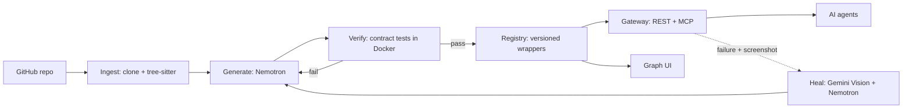

# Replic8 PRD

Status: draft v0.1 (2026-11-07). Requirement IDs match [requirements](requirements.md). Anything marked **TBD** or **verify** is undecided or unchecked. Don't treat it as fact.

## 1. Problem

Old software has no API and no MCP server, so AI agents can't use it. Rewriting it is slow and risky. Replic8 reads a legacy repo and generates a working API and MCP server around it, so agents can call it today.

## 2. Goal

Turn legacy source code from GitHub into an agent-ready API and MCP server, keep it working when the legacy system changes, and show how several systems connect.

**Hackathon success looks like (24h):** a live demo where we point Replic8 at 2 small legacy repos, get one unified MCP/API for both, call it from an AI agent, see the connections in a graph, then break something and watch Replic8 repair it.

## 3. Users

- **Primary:** a developer or company with old systems they want agents to use.
- **Secondary:** an AI agent that calls the generated tools.

## 4. Features

### F1. Legacy code to API/MCP (FR-1 to FR-5, FR-11)
1. User gives a GitHub repo URL.
2. Replic8 clones it and detects the language. **It must work on any language**, using three tiers (FR-11):
   - **Parsed:** a tree-sitter grammar exists, so we extract the real functions and signatures. The LLM only sees extracted symbols, not guesses.
   - **Inferred:** no grammar, so Nemotron reads the files and proposes entry points. Less trustworthy, so it relies entirely on the contract tests below.
   - **Black-box:** code can't be understood, so we wrap it as a command (args, stdin/stdout) or HTTP service and test it from the outside.

   Each operation is labeled `parsed`, `inferred` or `black-box` so users know how much to trust it.
3. Nemotron picks which functions to expose and writes the wrapper: a REST API (OpenAPI) and an MCP server.
4. Every exposed operation must point to a source location (`file:line`) and pass a contract test against the real legacy code. Operations that fail are not published.
5. The legacy code runs in a sandbox (Docker), never directly on the host.
6. Several systems register into one gateway with namespaced tools, e.g. `inventory.get_stock`, `billing.create_invoice`.

Reference: [api-anything](https://github.com/goodnight000/api-anything) is the model for the learn, call, repair loop, the MCP/OpenAPI outputs, and "save only after a replay works." It works on websites, not source code, so we reuse the ideas, not the code.

### F2. Self-healing (FR-7, FR-8)
When a wrapper breaks (contract test fails, runtime error, or an error popup in the demo app's UI):
1. Detect the failure and capture the error output and, if there's a UI, a screenshot.
2. Gemini Vision reads the screenshot; Nemotron diagnoses against the source and the old wrapper.
3. Regenerate the wrapper, replay the contract tests, and **save only if they pass**.
4. Store it as a new version; keep the old one for rollback.

### F3. Graph visualization (FR-6)
A web view of the unified API: nodes for systems and operations, edges for shared data and calls between systems. Edges come from matching schemas (real field names/types), not LLM guesses.

### F4. Extend (FR-9, stretch)
Add new functionality that doesn't touch the legacy code, such as a new endpoint that combines data from two systems. Lives in a separate `extensions/` module.

### F5. Manager updates via Photon, send-only (FR-12)
Replic8 texts status updates to one or more approved phone numbers (e.g. a manager) through [Photon](https://photon.codes), a messaging API for AI agents that sends over iMessage with SMS/RCS fallback.

- **Outbound only.** Replic8 never reads replies and never accepts commands over messaging. No inbound webhook is registered, so a text can't trigger any action. This is the "no write access" rule.
- **Events sent:** system onboarded, wrapper published, failure detected, self-heal started, repair saved as a new version, repair failed or rolled back.
- **Safe content:** short summaries only. Never source code, secrets, tokens, or raw customer data.
- **Allowlist:** numbers come from config (env var), not the repo.
- **Non-blocking:** if Photon is down, log it and keep going. A failed text must never stop a conversion or repair.
- **Noise control:** group repeated failures into one message.

## 5. Architecture

## 6. Technology choices

| Area | Choice | Why | Check |
|------|--------|-----|-------|
| Backend | Python + FastAPI | Auto-generates OpenAPI; easy to run legacy code as subprocesses | |
| MCP | Official MCP Python SDK | Same language as backend | verify current SDK API |
| Code parsing | tree-sitter | Real symbols reduce hallucination | confirm grammars for demo languages |
| Code analysis/generation | Nemotron via NVIDIA API | Your chosen model | **TBD** model name, rate limits, key |
| Screen understanding | Gemini (vision) via Google API | Your chosen model | **TBD** model name, key |
| Sandbox | Docker | Isolates untrusted legacy code | |
| Registry/versioning | Files + git in a `registry/` folder | No database to set up in 24h | |
| Graph UI | React + React Flow | Fast node/edge graphs | |
| Hosting | One cloud VM running docker compose | Simplest for a demo | **TBD** provider |
| Notifications | Photon (iMessage, SMS/RCS fallback) | Your chosen service; lets us text a manager without building messaging | **verify** pricing, rate limits, whether a send-only key exists, number provisioning |

## 7. Anti-hallucination rules (for humans and AIs)

- No operation without a source location and a passing test.
- Graph edges come from schemas, not from model opinion.
- If the docs don't say it, ask or log it under open questions. Don't invent.

## 8. 24-hour scope

| Priority | What | Reqs |
|----------|------|------|
| P0 | 2 demo legacy apps, ingest, generate, verify, gateway, MCP + REST | FR-1 to 5, 10 |
| P0 | Graph showing both systems and their links | FR-6 |
| P1 | Scripted break + auto-repair + new version saved | FR-7, 8 |
| P1 | Photon send-only text updates on key events | FR-12 |
| Stretch | 3rd demo app; extension module | FR-9, 10 |

Suggested order: demo apps and ingest, then generate and verify, then gateway, then graph, then self-healing, then polish the demo script.

## 9. Open questions

- [ ] Which languages for the demo apps? To prove "any language," pick one that is `parsed` (has a tree-sitter grammar) and one that goes through the `inferred` or `black-box` tier. Both need a simple Docker image.
- [ ] Do the demo apps have a UI (for the screenshot/vision step), or is healing driven by errors and tests only?
- [ ] Which Nemotron and Gemini models, and what API limits do we have?
- [ ] Which cloud provider and who owns the keys?
- [ ] What exactly will we break in the demo, and what does the repair look like on screen?
- [ ] Team roles: who owns ingest, generation, gateway, UI, demo apps?
- [ ] Security: who can call the gateway (token auth)? What data never leaves the machine?
- [ ] Photon: do we have an account and API key? Does it give us a send-only credential? Which number sends, and which number(s) receive?
- [ ] Photon: which events are worth a text, and how often before it becomes spam?

## 10. Risks

- "Any language" is a goal, not a guarantee. We prove it on the demo languages and label confidence per operation. Old languages also need their toolchain in the sandbox (picking the right Docker base image per repo is hard).
- Running legacy code from a repo is risky, so sandbox everything.
- Generated wrappers can be wrong in subtle ways, which is why tests gate publishing.
- 24 hours is tight. Cut F4 first, then the third demo app.
- Model API outages or rate limits during the demo. Keep a recorded fallback.
