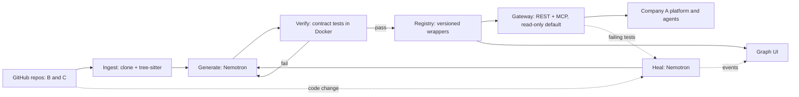

# REPLIC8 PRD

Status: draft v0.2 (2026-11-07). Requirement IDs match [requirements](requirements.md). Anything marked **TBD** or **verify** is undecided or unchecked. Don't treat it as fact.

## 1. Problem

Old software has no API and no MCP server, so AI agents can't use it. Rewriting it is slow and risky. REPLIC8 reads a legacy repo and generates a working API and MCP server around it, so agents can call it today.

## 2. Goal

Turn legacy source code from GitHub into an agent-ready API and MCP server, keep it working when the legacy code changes, and show how several systems connect.

**Hackathon success looks like (24h):** a live demo where REPLIC8 converts two legacy systems, a modern parent company's AI agent gets answers from both through one gateway, we see the connections in a graph, then we rename something in the legacy code and watch REPLIC8 repair the integration and show it in the dashboard's activity feed. Company A's agent connects over MCP.

## 3. Users

- **Primary:** a company (like Company A below) that acquires businesses and inherits their old software.
- **Secondary:** an AI agent that calls the generated tools.

## 4. Demo scenario

**Company A** is a modern parent company with its own modern platform, API, and AI agents. It acquires two businesses and inherits their legacy software, which has no usable APIs.

| Company | What it does | Legacy software it brings |
|---------|--------------|---------------------------|
| A: modern parent | Coordinates purchasing, operations, reporting, and technology across subsidiaries | None (modern platform and AI agents) |
| B: oilfield services | Services wells and maintains field equipment | Maintenance, equipment, procurement |
| C: industrial logistics/manufacturing | Makes replacement parts and moves equipment | Inventory, production, shipment |

REPLIC8 is the integration layer. It connects **legacy to modern** (A to B, A to C) and **legacy to legacy** (B to C).

**Demo flow:**
1. A replacement-pump request is recorded in B's legacy maintenance system.
2. A's platform uses a generated tool to retrieve that request.
3. Another generated tool checks C's inventory.
4. A combines the results to show available parts and delivery options.
5. We rename a function or field in a legacy repo. The integration breaks, REPLIC8 validates a repair, saves a new version, and the dashboard's activity feed shows each step.

**Authorization rule:** v1 only does lookups and recommendations (read-only). Purchasing or dispatching are write operations and stay disabled until explicitly authorized.

## 5. Features

### F1. Legacy code to API/MCP (FR-1 to FR-5, FR-11, FR-13)
1. User gives a GitHub repo URL.
2. REPLIC8 clones it and detects the language. **It must work on any language**, using three tiers (FR-11):
   - **Parsed:** a tree-sitter grammar exists, so we extract the real functions and signatures. The LLM only sees extracted symbols, not guesses.
   - **Inferred:** no grammar, so Nemotron reads the files and proposes entry points. Less trustworthy, so it relies entirely on the contract tests below.
   - **Black-box:** code can't be understood, so we wrap it as a command (args, stdin/stdout) or HTTP service and test it from the outside.

   Each operation is labeled `parsed`, `inferred` or `black-box` so users know how much to trust it.
3. Nemotron picks which functions to expose and writes the wrapper: an MCP server (the main interface for agents) and a REST API (OpenAPI) with the same tools. Each operation is marked `read` or `write`; **write operations are disabled by default** (FR-13).
4. Every exposed operation must point to a source location (`file:line`) and pass a contract test against the real legacy code. Operations that fail are not published.
5. The legacy code runs in a sandbox (Docker), never directly on the host.
6. Several systems register into one gateway with namespaced tools, e.g. `maintenance.get_request`, `inventory.check_stock`.

Reference: [api-anything](https://github.com/goodnight000/api-anything) is the model for the learn, call, repair loop, the MCP/OpenAPI outputs, and "save only after a replay works." It works on websites, not source code, so we reuse the ideas, not the code.

### F2. Self-healing (FR-7, FR-8)
Triggered when a wrapper breaks, meaning its contract tests fail after the legacy code changes (e.g. a renamed function or field):
1. Detect the failure (scheduled test run, or a new commit on the legacy repo).
2. Nemotron compares the old wrapper with the current source (the git diff) and diagnoses what changed.
3. Regenerate the wrapper, replay the contract tests, and **save only if they pass**.
4. Store it as a new version; keep the old one for rollback.
5. Record each step in the activity log, which the dashboard shows (F5).

No screenshots or vision model in v1.

### F3. Graph visualization (FR-6)
A web view of the unified API: nodes for companies/systems and operations, edges for shared data and calls between systems (A to B, A to C, B to C). Edges come from matching schemas (real field names/types, e.g. a shared part ID), not LLM guesses.

### F4. Extend (FR-9, stretch)
Add new functionality that doesn't touch the legacy code, such as a new endpoint that combines data from two systems. Lives in a separate `extensions/` module.

### F5. Status updates (FR-12: Photon dropped)
Photon was dropped (2026-11-07). Status events go to the activity log (`GET /v1/events`), which the dashboard shows. No texts are sent and nothing is received.

- **Events logged:** system onboarded, wrapper published, contract failed, change detected, self-heal started, repair saved as a new version, repair failed, rolled back.
- **Safe content:** identifiers, versions, counts and fixed event kinds only. Never source code, secrets, tokens, or raw customer data.
- **Non-blocking:** recording an event never stops a conversion or repair.
- **Noise control:** group repeated failures into one message.

## 6. Architecture

## 7. Security interfaces

Everyone must use these functions.

| Function | Status | When to use | Rules | Owner |
|----------|--------|-------------|-------|-------|
| `Validator.validate_call(token, tool_name, args)` (`backend/replic8/validator.py`) | Built | At the start of every gateway route (REST and MCP). | REST and MCP both use it. Raises `Denied` with 401 for a bad token, 403 on admin routes for a non-admin token (admin tokens, `REPLIC8_ADMIN_TOKENS`, are separate and unscoped), 429 over the rate limit, 403 if the tool is outside the token's scopes (`REPLIC8_TOKEN_SCOPES`; no scopes means no access) or is a write operation, 404 if the tool isn't published, 413 over 64 KB, 422 for bad input. Logs every call to the audit log. | Security |
| `Sandbox.run(image, code_dir, argv, payload)` (`backend/replic8/sandbox.py`) | Built | Any time B or C legacy code runs (contract tests, gateway calls, heal retests). Never run legacy code directly. | Each call gets a fresh, locked Docker container (B = GnuCOBOL): no network, read-only, non-root, resource limits, timeout. Images are pinned by digest and never pulled at call time. Raises `SandboxError` (base error) for setup problems. Timeouts and crashes are reported as result fields (`timed_out`, `exit_code`, `output_too_large` on `SandboxResult`) that the error handler reads. The executor turns those fields into `SandboxTimeout` and `SandboxCrash`, and wrong output or a renamed function into `OutputSchemaError` and `FunctionMissing` (all built). `Sandbox.build` compiles legacy code through `Sandbox.run` with only the build folder writable. | Security |
| `trigger_heal(tool_name, error_info)` (`Pipeline` in `backend/replic8/pipeline.py`) | Built | Called by the error handler only on `OutputSchemaError` or `FunctionMissing`. | A repair must not change a tool's read/write access, and is saved only if contract tests pass. | Backend |
| ~~`notify(event, *, system, version, count)`~~ | Removed 2026-11-08 | Photon was dropped; status goes to the activity log (`EventLog` in `backend/replic8/events.py`). | Events carry only identifiers, versions, counts and fixed kinds; no code or data. | Security |

## 8. Technology choices

| Area | Choice | Why | Check |
|------|--------|-----|-------|
| Backend | Python + FastAPI | Auto-generates OpenAPI; easy to run legacy code as subprocesses | |
| MCP | Official MCP Python SDK | Same language as backend | verify current SDK API |
| Code parsing | tree-sitter | Real symbols reduce hallucination | confirm grammars for demo languages |
| Code analysis/generation/healing | Nemotron via NVIDIA API | Your chosen model; the only model in v1 | **TBD** model name, rate limits, key |
| Sandbox | Docker | Isolates untrusted legacy code | |
| Registry/versioning | Files + git in a `registry/` folder | No database to set up in 24h | |
| Graph UI | React + React Flow | Fast node/edge graphs | |
| Hosting | Vercel (frontend) and one Vultr Ubuntu server with Docker and Caddy (backend) | Simplest for a demo | **Decided 2026-11-08** (`deploy/README.md`) |
| Notifications | Photon (iMessage, SMS/RCS fallback) | Your chosen service; texts a project owner without building messaging | **verify** pricing, rate limits, whether a send-only key exists, number provisioning | **Dropped 2026-11-08.**

## 9. Anti-hallucination rules (for humans and AIs)

- No operation without a source location and a passing test.
- Graph edges come from schemas, not from model opinion.
- If the docs don't say it, ask or log it under open questions. Don't invent.

## 10. 24-hour scope

| Priority | What | Reqs |
|----------|------|------|
| P0 | Modern Company A stand-in plus legacy systems B and C, ingest, generate, verify, gateway, MCP + REST | FR-1 to 5, 10, 11, 13 |
| P0 | Graph showing A, B, C and their links | FR-6 |
| P1 | Rename a function/field, auto-repair, new version saved | FR-7, 8 |
| ~~P1~~ | ~~Photon send-only text updates on key events~~ (dropped 2026-11-08) | FR-12 |
| Stretch | Extension module; extra legacy modules | FR-9 |

Suggested order: build the demo systems and ingest, then generate and verify, then gateway, then graph, then self-healing, then polish the demo script. Keep each legacy system to 2 or 3 read operations.

## 11. Open questions

- [x] Which languages for B and C? **Decided 2026-11-07:** B is COBOL, C is Fortran. Both have tree-sitter grammars, so both can be `parsed`. Both demo systems use the `parsed` tier (Aryan, 2026-11-07); a `black-box` Fortran path is a stretch goal if time allows. **Changed 2026-11-08:** C is now legacy Java (see requirements decisions).
  Original question: To prove "any language," one should be `parsed` (has a tree-sitter grammar) and one should go through the `inferred` or `black-box` tier. Both need a simple Docker image.
- [x] Which Nemotron model, and what API limits and key do we have? **Decided 2026-11-07:** `nvidia/nemotron-3.5-super-vl-120b-a12b` (early access). Key is in Aryan's cloud environment secrets, not the repo. Rate limits still unknown.
- [x] Which cloud provider and who owns the keys? **Decided 2026-11-08:** Vercel (frontend, Jai) and Vultr (backend). Still open: the backend hostname, and who holds the Vultr account and the admin token.
- [ ] What shared key links B and C (e.g. a part ID) so the graph edge and the combined answer are real?
  **Proposed 2026-11-08 (in the demo systems):** part ID (e.g. `PMP-2210`) and site region (e.g. `PERMIAN`). See `legacy/README.md`. Team to confirm.
- [ ] Should each demo legacy system live in its own GitHub repo, so REPLIC8 ingests it by URL? (Currently both are in `legacy/` in this repo.)
- [ ] Where does the "combine B and C" step live: in Company A's agent, or as a cross-system operation inside REPLIC8?
- [ ] Team roles: who owns ingest, generation, gateway, graph UI, the demo systems?
- [ ] Security: who can call the gateway (token auth)? What data never leaves the machine? How are write operations authorized later?
- [x] ~~Photon: do we have an account and API key? Does it give us a send-only credential? Which number sends, and which receives?~~ Photon dropped 2026-11-08.
- [x] ~~Photon: which events are worth a text, and how often before it becomes spam?~~ Photon dropped 2026-11-08.
- [x] Proposed (backend): Nemotron never writes code. **Decided 2026-11-07** after live testing (see requirements decisions). REPLIC8 builds each call itself, so we need a small call shim per language (COBOL, Fortran).
- [ ] Do the demo legacy systems need a writable database or folder? The sandbox is read-only and offline by default.
- [ ] Registry history: plain versioned files (built) or also a git commit per version (PRD section 8)?
- [ ] Who holds the gateway tokens, and do we need per-caller scopes after the demo?

## 12. Risks

- "Any language" is a goal, not a guarantee. We prove it on the demo languages and label confidence per operation. Old languages also need their toolchain in the sandbox (picking the right Docker base image per repo is hard).
- Running legacy code from a repo is risky, so sandbox everything.
- Generated wrappers can be wrong in subtle ways, which is why tests gate publishing.
- 24 hours is tight. Cut F4 first, then extra systems.
- Model API outages or rate limits during the demo. Keep a recorded fallback.
